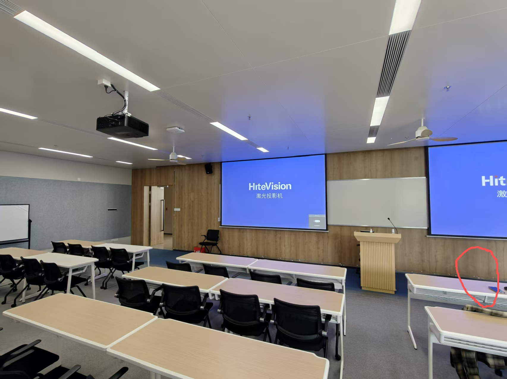
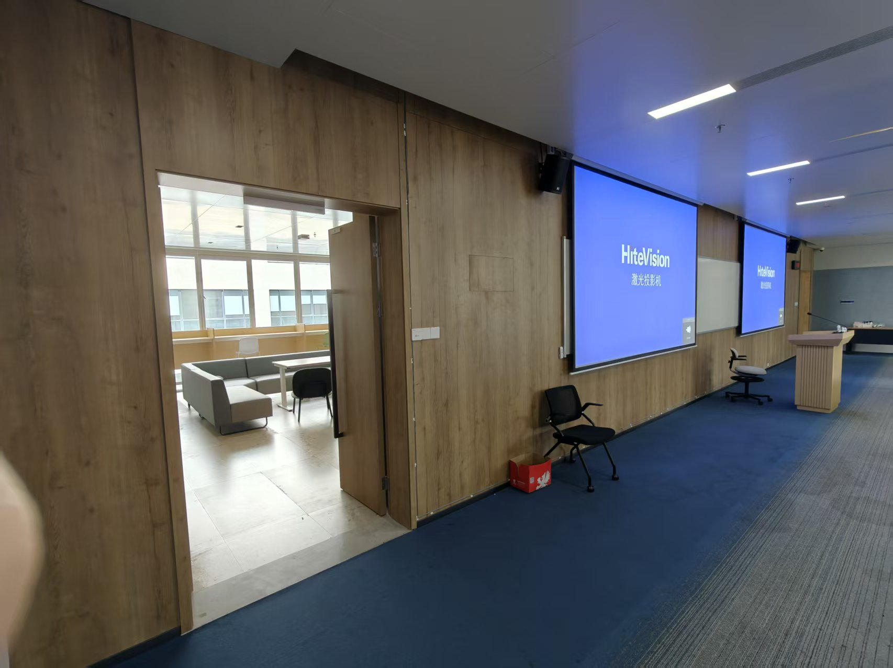
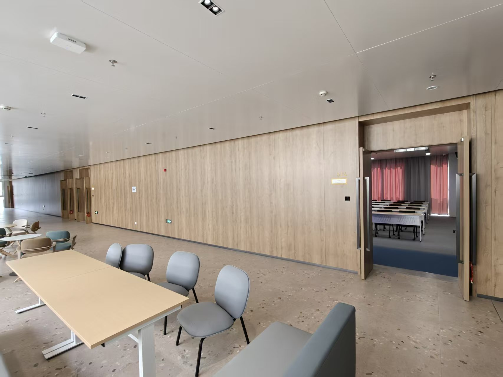
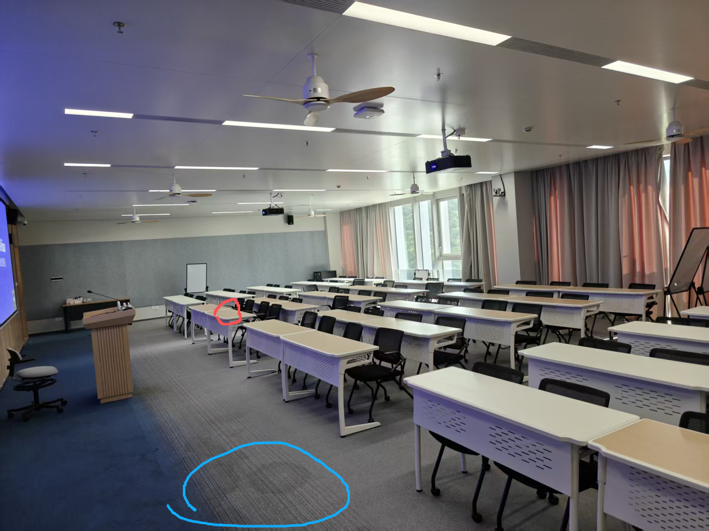
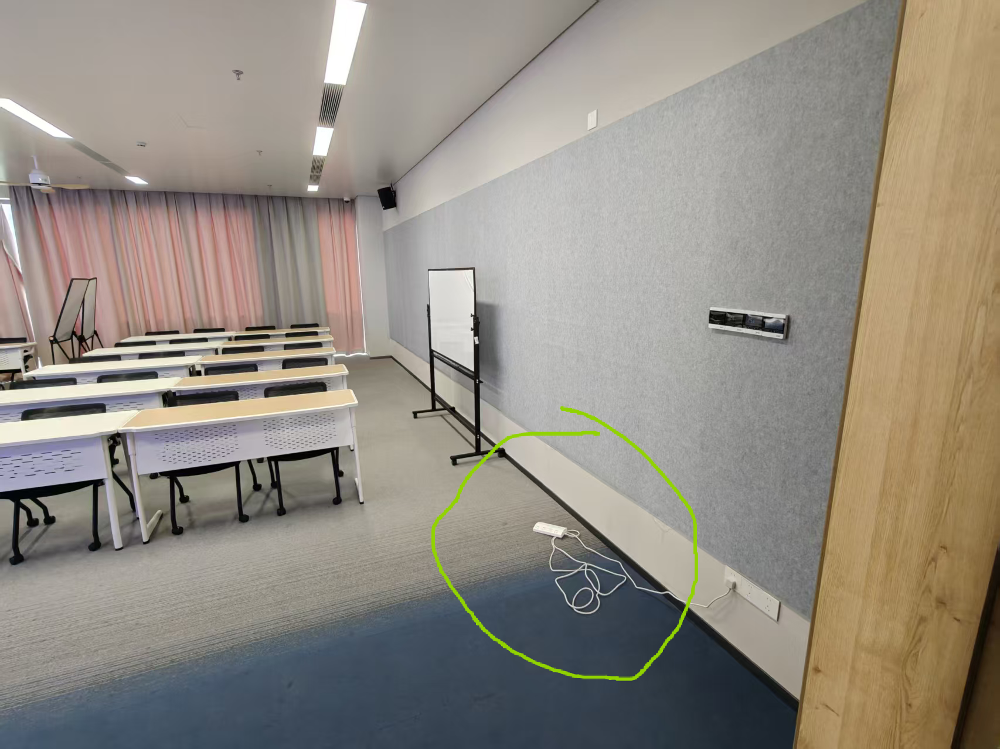

# 6B514 CSI 实验场地记录

记录日期：2026-10-21。依据：用户提供的五张场地照片及文字说明。
关联数据：采集数据.zip（首次采集记录）。照片用于解释空间布局，不是与CSI同步的实验视频，不能据此确认每个时间段的人员、动作或设备运行状态。

## 项目边界

最终任务为同一间固定房间内的有人／无人判断，无跨房间泛化要求。当前已训练探索模型的任务仍为运动／无运动，两种标签不可混用。外部人员只有在进入目标房间后才计入室内有人；具体门槛边界及过渡片段的标注方式仍需统一。

## 五张照片的对应说明

| 编号 | 原文件名 | 用户确认的说明 |
|---|---|---|
| 图1 | image(20261021-054840).png | 红圈为ESP32位置；画面左侧的门即数据文件名中所指的门。课桌前方与投影幕布之间的小走道为实际室内走动测试区域。 |
| 图2 | 456b45937e4dd7834bda70df8775df63(1).jpg | 从房间内部向同一个门外拍摄，用于说明门外相邻区域。 |
| 图3 | 2e1aaf498ff8f5b6d366022b308e761d(1).jpg | 从门外向房间内拍摄，展示入口与室内的空间关系。 |
| 图4 | image(20261021-055131).png | 从门口向房间内部、偏左拍摄。蓝圈为“玩电脑”录制时人员实际坐着的大概位置；红圈为ESP32位置。 |
| 图5 | image(20261021-055242).png | 与图4拍摄位置相同，镜头偏右；绿圈为路由器的放置位置。此位置由用户说明确认，照片不能确定路由器具体型号、朝向或高度。 |

红圈、蓝圈、绿圈均为近似位置标记，不是实测坐标。图1与图4中的红圈按用户说明记录为同一ESP32位置的不同视角，不能由此推定两块ESP32分别位于这两个圈内。

## 与数据文件的关联

- “走动”系列：用户描述的测试区域为课桌前方与投影幕布之间的小走道；具体起终点、速度和停顿尚未记录。
- “玩电脑”系列：人员位于图4蓝圈附近，具体座椅位置、朝向、打字与停顿时间尚未确认。
- “门口走”：对应图1左侧、图2与图3所展示的同一扇门；人在门内、门外或跨门槛移动仍未确认。原始元数据action为“隔墙走”，不能只凭名称直接确定占用标签。
- “起身出教室”：涉及房间有人到无人的可能转变，准确离开时间和是否还有其他人在室内尚需确认。
- “设备旁挥手”：设备的近似位置现有照片可辅助解释；挥手者相对距离、朝向和持续动作区间尚未确认。
- “风扇无人”：照片可见多个吊扇，但无法据此认定测试使用哪一个、开启数量或档位。
- 首批15份JSONL记录的device字段均为c5628c。照片红圈设备ID以及第二块ESP32的位置、角色和是否同时工作尚未核对。

## 足够用于什么

这些材料足够作为第一轮实验的定性场地介绍、组内解释和后续实验方案的背景。它们不能单独提供精确布局复现、信号覆盖范围、门外干扰结论或按时间段的真实标签。

## 后续优先补充

1. 两块ESP32各自ID、放置位置、角色、是否同时工作；路由器和接收设备的大致间距、离地高度及朝向。不得从照片估算并填成实测值。
2. “门口走”在门内还是门外；各段录制时门开关状态、室内总人数，操作者是否留在房间内。
3. 风扇测试实际使用哪台或哪几台风扇，位置、档位；其余实验风扇及空调开关状态。
4. 给室内走动起点/终点、打字位置和设备位置编号；记录家具与设备是否移动。
5. 下一轮同步视频或可核对的动作时间记录；本次记不清的条件保留“未记录”，不要补写为已确认事实。

建议下次补一张简易俯视草图，标出房间大致长宽、门、设备、人员位置及走动路线。无需专业制图，也无需为此更换现有采集场地。

## 场地照片

### 图1

红圈为ESP32；左侧为数据文件名所指的门；课桌前方与投影幕布之间的小走道是室内走动测试区域。

### 图2

从房间内部向同一扇门外拍摄。

### 图3

从门外向房间内部拍摄。

### 图4

从门口向室内偏左拍摄。蓝圈为玩电脑时人员的大概位置，红圈为ESP32位置。

### 图5

与图4拍摄位置相同，向右拍摄。绿圈为用户确认的路由器放置位置。

